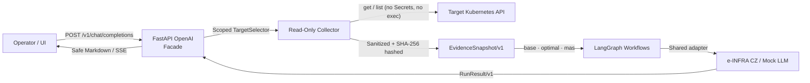

# RCAnnon

AI-powered tool helping teams find the root causes of Kubernetes incidents.

When a Kubernetes cluster breaks—networking, storage, probes, RBAC, or
resource limits—RCAnnon runs on an independent management host, collects a
redacted read-only snapshot, and compares three LangGraph diagnostic
workflows (`base`, `optimal`, and parallel `mas`) over the exact same
evidence.

## How It Works

> **Diagram exceeds terminal width (287 > 80 cols)**
> Displayed as code block. Widen terminal to view inline.



- **Out-of-cluster & read-only:** Runs in Docker Compose outside target
failure domains; never reads `Secret` values, runs `pod exec`, or mutates
the cluster.
- **Controlled comparisons:** Feeds identical `EvidenceSnapshot/v1` hashes
to single-agent (`base`, `optimal`) and 4-call parallel multi-agent
(`mas`) LangGraph workflows.
- **Honest degradation:** Reports missing or forbidden telemetry
explicitly (`qualified` / `insufficient_evidence`) instead of guessing.

## Quick Start

```sh
git clone https://github.com/jkuzel02/RCAnnon.git
cd RCAnnon
./infrastructure/compose/scripts/init-dev-secrets.sh
RCANNON_IMAGE=ghcr.io/jkuzel02/rcannon:0.1.0 docker compose up -d         
--no-build --wait                                                         
```

Full walkthroughs (local build, live e-INFRA CZ, read-only kubeconfig, and
`uv` dev setup) are in
**[docs/getting-started.md](./docs/getting-started.md)**.

## Documentation

- **[Getting Started](./docs/getting-started.md)** — quickstart,
prerequisites, and workflow overview
- **[Architecture & `v1` Contracts](./docs/architecture.md)** — trust
boundaries, snapshots, workflows, and API surface
- **[Container Image](./docs/container-image.md)** — GHCR tags (`0.1.0`,  
`main`, `sha-*`), runtime config, and SLSA provenance
- **[Compose Operations](./infrastructure/compose/README.md)** — secret
mounts, Linux/macOS Kind reachability, and backups
- **[Incident Scenarios](./docs/scenarios.md)** & **[Kubernetes
Lab](./infrastructure/k8s/README.md)** — 16 Kind/Flux scenarios
- **[Testing Guide](./docs/testing.md)** · **[Changelog](./CHANGELOG.md)**
· **[Contributing](./CONTRIBUTING.md)**
