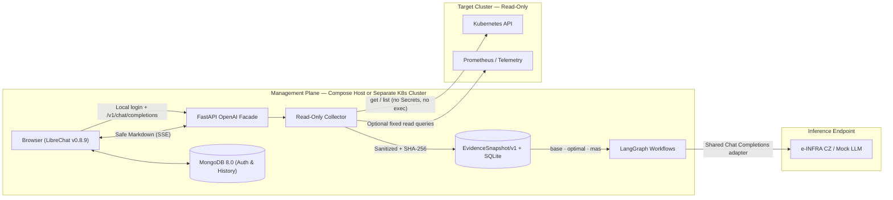

<div align="center">

# RCAnnon

**Out-of-Cluster AI Root Cause Analysis for Kubernetes**
*Read-only. Blast-radius proof. Evidence-verified.*

[](./docs/container-image.md)
[](./pyproject.toml)
[](./docs/architecture.md)
[-0F766E?style=flat-square)](./infrastructure/compose/librechat.yaml)
[](./docs/scenarios.md)
[](./LICENSE)

[Why RCAnnon](#why-rcannon) · [How It Works](#how-it-works) · [Workflows](#three-workflows-one-snapshot) · [Documentation](#documentation) · [Security](#security) · [Contributing](#contributing)

</div>

---

When production pods crash-loop at 2 AM, in-cluster dashboards go dark, copy-pasting logs leaks credentials, and unconstrained LLM chats happily hallucinate root causes over missing telemetry.

**RCAnnon** runs off-cluster on an independent management host. It captures a **redacted, read-only Kubernetes evidence snapshot** once, freezes it under a **single SHA-256 hash**, and lets you run three comparable LangGraph workflows—`base`, `optimal`, and parallel multi-agent `mas`—over the **exact same evidence**.

## Why RCAnnon?

| Common Pain Point | How RCAnnon Solves It |
| --- | --- |
| **In-cluster tools die during outages** | Runs independently on a **Docker Compose host** or inside a **separate management Kubernetes cluster**, with zero dependency on the target cluster's CNI, ingress, or monitoring stack. |
| **Ad-hoc debugging leaks cluster secrets** | Enforces strict `get` / `list` read-only RBAC and allowlisted namespaces—**never reads `Secret` values, runs `pod exec`, or mutates resources**, and scrubs bearer tokens before storage or inference. |
| **Agents invent causes over missing telemetry** | Deterministic claim validation in `mas` cross-checks cited `Kind/name` objects, logs, and metrics against the snapshot; missing signals surface honestly as `qualified` or `insufficient_evidence`. |
| **Single- vs. multi-agent comparisons drift** | Replays identical immutable `EvidenceSnapshot/v1` hashes across single-call and multi-agent strategies with deterministic mock and live OpenAI-compatible adapters. |

## How It Works



## Three Workflows, One Snapshot

Select a model directly in LibreChat and send an `/rca` prompt to diagnose an incident or compare approaches side by side:

| Model Alias | Strategy | Model Calls | Output Contract | Strength |
| --- | --- | --- | --- | --- |
| `rcannon-base` | Single-agent free-form | **1** | Unconstrained Markdown diagnosis | Fast narrative baseline |
| `rcannon-optimal` | Structured single-agent | **1** | Schema-validated 5-field RCA JSON | Compact, deterministic single-call diagnosis |
| `rcannon-mas` | 3 parallel specialists -> coordinator | **4** | 5-field RCA + claim cross-checks | Separates config/events, logs/checks, and metrics before synthesis |

<details>
<summary><strong>Preview: Structured 5-heading diagnosis &amp; honest degradation output</strong></summary>

Structured responses (`rcannon-optimal` and `rcannon-mas`) stream safely sanitized Markdown:

```markdown
## Cause
Container `checkout` exceeds its `256Mi` memory limit (`OOMKilled`, exit code `137`).

## Causal Chain
Burst traffic increases in-memory cache allocation -> cgroup hits `limits.memory: 256Mi` -> kubelet terminates container -> Pod enters `CrashLoopBackOff`.

## Supporting Evidence
- Pod/checkout-api-7f9d4c terminated with reason `OOMKilled` (exitCode=137)
- Event `BackOff`: restarting failed container `checkout` in namespace `demo`

## Remediation
Increase `spec.template.spec.containers[0].resources.limits.memory` and bound cache size under peak load.

## Recovery Check
Confirm `Pod/checkout-api-*` remains `Ready=True` with zero `OOMKilled` restarts for 10 minutes.
```

When neither live cluster telemetry nor a registered bundle snapshot provides usable evidence, RCAnnon refuses to guess and returns `insufficient_evidence` listing the exact degraded or unreachable sources (`events`, `logs`, `metrics`, `checks`).

</details>

## "So I Can't Run RCAnnon Inside a Kubernetes Cluster?"

**You absolutely can.** Docker Compose is our zero-friction reference setup, not a deployment limit—RCAnnon publishes standard multi-arch OCI container images (`ghcr.io/jkuzel02/rcannon` + LibreChat + MongoDB) that run anywhere containers run.

- **Recommended — Standalone host (Compose) or a separate management Kubernetes cluster:** The architectural intent is simply to stay *outside the failing target cluster's blast radius*. Running RCAnnon inside another management or ops cluster works great—mount target read-only kubeconfigs and secrets into the API pod, and diagnose remote clusters normally.
- **Not recommended — Inside the same target cluster you are diagnosing:** Nothing prevents deploying it there technically, but if CNI, CoreDNS, ingress, or etcd breaks in that cluster, RCAnnon goes down alongside the outage.

## Documentation

Ready to try or deploy RCAnnon? See [Getting Started](./docs/getting-started.md) for the quick start, live cluster setup, and user documentation.

## Security

RCAnnon isolates credentials, enforces read-only Kubernetes RBAC, and signs container releases with SLSA provenance; see [Security](./SECURITY.md) for our threat model, container posture, and vulnerability reporting process.

## Contributing

Contributions are welcome and appreciated! See [Contributing](./CONTRIBUTING.md) for our guidelines and [Code of Conduct](./CODE_OF_CONDUCT.md) for community standards.

## License

Licensed under the [Apache License 2.0](./LICENSE).
