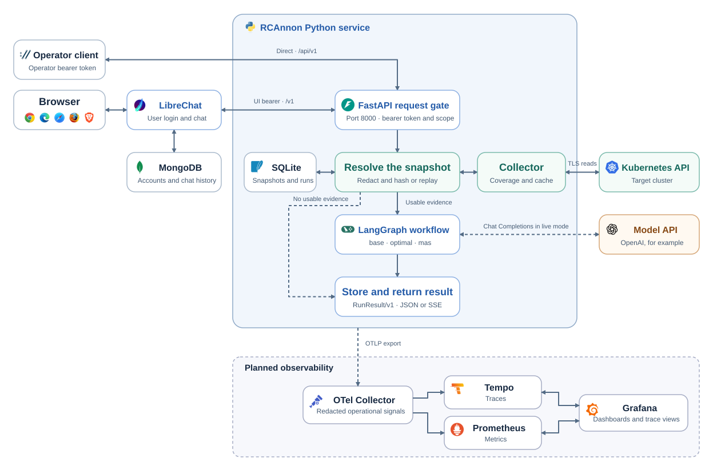

# RCAnnon Architecture and Compatibility Contracts

- **Status:** Ratified (`Refs #5`)
- **Contract Version:** `v1`
- **Last Verified:** `2026-11-20`

## 1. Purpose and Baseline

This document is the Architecture Decision Record (ADR) and versioned compatibility specification for RCAnnon. It defines the system boundaries, failure domains, shared data envelopes, workflow invocation contract, API surface, security controls, and evaluation protocol so all module owners can implement and verify components independently without contract drift.

At ratification of `v1`, the repository already provides:

- Canonical JSON schemas, prompt allowlists, and typed provider error contracts in `rca/contracts/`.
- The shared Chat Completions provider configuration and adapter in `rca/providers/`.
- All three compiled LangGraph workflows (`base`, `optimal`, `mas`) behind `rca.workflows.build_workflow` in `rca/workflows/`.
- Sixteen Kubernetes incident scenarios in `scenarios/`, unchanged prompts in `prompts/`, and prompt smoke checks in `evaluation/prompt_checks/`.
- Kind, Flux, Prometheus, and Grafana lab manifests in `infrastructure/`.

Downstream modules (`rca/evidence/`, `rca/api/`, Docker Compose packaging, LibreChat integration, OpenTelemetry export, and the live benchmark harness) consume the contracts ratified here.

## 2. Architecture and Failure Domains

RCAnnon diagnoses Kubernetes incidents from an independent management host and compares three LangGraph approaches under controlled conditions.

[Editable Draw.io source with overview and runtime pages](diagrams/architecture.drawio)

The box marks the RCAnnon Python service and its SQLite store. LibreChat and MongoDB are separate services that can run alongside it on the same management host. Two-way arrows show request and response exchanges or shared reads and writes. The Kubernetes exchange uses read-only access.

FastAPI listens on port `8000` and can run without LibreChat or MongoDB. Clients with network access can call the OpenAI-compatible routes using the UI bearer token or the snapshots and runs routes using the separate operator bearer token. The default Compose stack publishes only LibreChat to the host. The standalone container example shows how to publish the API on host loopback. [Compose configuration](../compose.yaml) · [Standalone API container](container-image.md#hardened-standalone-container-mock-mode)

The collector uses a read-only kubeconfig with TLS to query the target Kubernetes API. The architecture also allows configured reads from external retained telemetry. See [Observability](#observability) for the OTLP export design.

### How an Incident Request Runs

1. **Authenticate and authorize.** The browser signs in to LibreChat. LibreChat owns the user account and chat history in MongoDB and forwards the request over the private `ui_api` network with its server-side bearer token. FastAPI maps the selected model to a workflow, parses the current `/rca` directive, and checks the target alias and namespaces against the server allowlist. Operator endpoints use a separate token and can register a snapshot bundle for later replay. [Compose services](../compose.yaml) · [API request handling](../rca/api/app.py)
2. **Resolve the evidence.** A live request uses the collector bound to the selected target. It reads only authorized sources and records coverage per source, so an empty result can be distinguished from a denied, unavailable, or truncated source. If live collection fails, the collector can reuse a fresh cache entry for the same target scope. An explicit snapshot ID instead loads an unexpired snapshot from SQLite and rechecks its scope. [Collector](../rca/evidence/collectors.py) · [Run service](../rca/api/service.py)
3. **Prepare the workflow input.** The service redacts live evidence before computing the canonical scope hash and persisting the snapshot. Registered bundles go through validation and redaction before storage. Each workflow receives a copy of the stored context. Reusing a snapshot ID across variants keeps the evidence fixed, and an optional incident description can change the working copy without changing the stored snapshot. [Snapshot contract](#evidencesnapshotv1) · [Run service](../rca/api/service.py)
4. **Run diagnosis within a deadline.** If the snapshot has no usable evidence, the service records `insufficient_evidence` before making a model call. Otherwise the worker invokes `base` or `optimal` with one logical call, or `mas` with three specialist calls followed by the coordinator. The API enables MAS evidence validation against the snapshot, and the shared completion interface selects the mock provider or an OpenAI-compatible endpoint. [MAS workflow](../prompts/mas/README.md#1-multi-agent-architecture) · [Provider selection](../rca/api/server.py)
5. **Persist and return the outcome.** FastAPI records a `running` entry in SQLite before the worker starts and then writes the terminal `RunResult/v1`. Degraded but usable evidence produces `qualified` with coverage limitations. A deadline or disconnect can terminate the run, and a restart marks stale running entries as interrupted. For chat, the facade renders the final result as sanitized Markdown, then returns it as JSON or OpenAI-compatible SSE. Operator clients receive the typed result. [Run storage](../rca/api/storage.py) · [Chat response handling](../rca/api/app.py)

### Data Ownership and Retention

| Store | Owns | Lifecycle |
| --- | --- | --- |
| MongoDB | LibreChat accounts and conversation history | Retained in the Compose `rcannon_mongo_data` volume. Chat history is presentation state. |
| SQLite | Redacted snapshots and run records, including status, coverage, and usage | The Python app opens the file in `rcannon_api_data` through its standard-library `sqlite3` module. Snapshots expire, and both snapshots and runs have separate count limits. |
| Collector cache | Usable evidence from recent live reads, keyed by target scope | In-process and bounded. A cached result retains its original observation time and is marked as degraded. |

### Management-Host Placement and Reachability

- Run Docker Compose on a workstation or separate management host or VM outside the target cluster and outside its CNI, ingress, CSI, monitoring, and node failure domains.
- Production placement requires an independently reachable Kubernetes API endpoint, host DNS, model provider egress, and authentication external to the target cluster.
- A co-located Kind cluster is valid for repeatable lab testing and does not prove host failure tolerance.
- A kubeconfig server address pointing to host loopback is not automatically reachable from inside containers. Linux and macOS Docker Desktop deployments must use a routable API address or an explicitly configured host relay with matching CA and certificate SAN while preserving TLS verification.
- The RCA service stays available when the target cluster or target workloads fail.

### API Capability and Degradation Semantics

| Condition | What the caller sees |
| --- | --- |
| Scope denied or the requested snapshot has expired | The API rejects the request before starting a run. It returns HTTP `403` for a denied scope and `404` for a missing or expired snapshot. |
| Usable evidence and successful workflow | The run ends as `diagnosed` with an RCA result. |
| Usable evidence with degraded coverage or a cache fallback | The run ends as `qualified` with source limitations. Collection can continue across individual denials, endpoint failures, or truncation. |
| No usable evidence | The run ends as `insufficient_evidence` with `result: null` and zero model calls. |
| Provider failure or invalid model output | The run is stored as `failed` and the request returns HTTP `503`. An operator can inspect the stored run for the sanitized error code and any coverage data. |
| Run deadline or provider timeout | The run is stored as `failed` and the request returns HTTP `504`. |
| Client disconnect or restart with a stale running record | The store records the run as `interrupted`. A disconnect signals cancellation to the worker, which checks the signal before and after each model call. |

The worker pool bounds active runs. The overall run deadline includes time waiting for a worker. The live model adapter also has its own deadline and per-attempt timeout. It defaults to zero retries and can retry eligible transient errors within its deadline when configured to do so. [Run service](../rca/api/service.py) · [Provider adapter](../rca/providers/openai.py) · [Provider configuration](../rca/providers/config.py)

Control-plane reads can still surface rollout conditions, `FailedScheduling` and `FailedCreatePodSandBox` events, `EndpointSlice` state, PV/PVC conditions, and route status during data-plane outages. Log and aggregated metrics endpoints can fail independently of healthy API discovery. Evidence adapters must distinguish static DNS configuration and recorded checks from an active DNS probe, note that a reachability probe from the management host describes that host's path only, and preserve source origin and time windows.

## 3. Technology Selections

| Area | Selection and Rationale |
| --- | --- |
| Runtime | Python `3.12` managed via `uv` and `.python-version`, matching CI. Use LangGraph `StateGraph` and FastAPI. |
| Collector | Official Kubernetes Python client (`ApiClient` per context) scoped to read-only cluster access. |
| Provider | Shared OpenAI-compatible Chat Completions adapter (`langchain-openai` / `openai`) targeting OpenAI or any compatible endpoint. |
| Frontend | LibreChat `v0.8.9` (MIT) selected over Open WebUI (licensing/operational tradeoffs) and Hugging Face Chat UI (deferred). All UIs integrate via the same OpenAI-compatible HTTP facade rather than native LangGraph execution. |
| Telemetry | The planned export uses OpenTelemetry Collector, Tempo, Prometheus, and Grafana outside the target cluster. The current MAS workflow supports a callback for per-agent execution traces. |
| Persistence | LibreChat owns MongoDB for user accounts and conversation history. Single-instance FastAPI runtime stores bounded redacted snapshot and run metadata in SQLite. |

## 4. Shared Compatibility Contracts (`v1`)

### `TargetSelector`

`TargetSelector` defines the operator-authorized scope for live evidence collection:

- `context_alias`: required safe identifier resolved against an immutable server-side allowlist.
- `namespaces`: non-empty list of allowlisted namespace identifiers.
- `workload_selector`: optional label or workload selector string without control characters.
- `time_window`: optional `string | object | null` UTC observation window.

Each context maps to a dedicated Kubernetes `ApiClient` with isolated credential and rate-limit state; the runtime must never mutate the process-global kubeconfig or default context. Client requests may supply aliases and allowlisted namespaces only—reject client-supplied hosts, paths, credentials, `exec` options, and arbitrary query text.

### `IncidentContext`

`IncidentContext` preserves the canonical `context` object shape defined by `rca.contracts.schemas.CASE["properties"]["context"]`:

- `incident`: non-empty incident summary string.
- `time_window`: `null`, string, or structured window object.
- `resources`: array of normalized Kubernetes resource objects.
- `events`: array of normalized event records.
- `logs`: array of bounded, redacted container log entries.
- `metrics`: array of collected metric observations.
- `checks`: array of diagnostic check records.

Adapters must preserve empty arrays and nullable `time_window` semantics, derive references and resource limits from normalized resources, and keep names, namespaces, container identifiers, timestamps, and quantities intact. Evidence is clipped, redacted, canonically serialized, and hashed once, then reused identically across all three workflow variants. Ground truth—including `root-cause`, scenario file paths, fault overlays, fault labels, expected outcomes, and recovery captures—remains strictly evaluator-only and is never passed to the model.

### `EvidenceSnapshot/v1`

`EvidenceSnapshot/v1` is the internal versioned envelope wrapping `IncidentContext` and per-source provenance without altering the `rca.json` schema (`additionalProperties: false`):

| Field | Type | Description |
| --- | --- | --- |
| `schema_version` | `"v1"` | Fixed contract version string. |
| `snapshot_id` | `string` | Opaque snapshot identifier. |
| `scope_hash` | `string` | Lowercase hex SHA-256 digest of canonical JSON (`sort_keys=True`, compact separators) over `{"context_alias", "namespaces", "context"}`. |
| `source_type` | `"live" \| "cached" \| "bundle" \| "fixture"` | Provenance of the evidence payload. |
| `context_alias` | `string \| null` | Target cluster alias when collected from a cluster. |
| `namespaces` | `string[]` | Scoped namespaces associated with the snapshot. |
| `collected_at` | `string` | UTC ISO-8601 timestamp with `Z` suffix when snapshot was built. |
| `observed_at` | `string \| null` | UTC ISO-8601 timestamp with `Z` suffix of the underlying observation, or `null`. |
| `context` | `IncidentContext` | Canonical redacted evidence payload. |
| `coverage` | `object` | Map from canonical source (`resources`, `events`, `logs`, `metrics`, `checks`) to `SourceCoverage`. |

Each `SourceCoverage` object has `additionalProperties: false` and fields:

- `status`: one of `observed`, `observed_empty`, `not_requested`, `unsupported`, `forbidden`, `unreachable`, `timeout`, `truncated`, `invalid`.
- `count`: non-negative integer item count.
- `reason`: optional `string | null` bounded machine-readable reason code.
- `truncated`: boolean indicating whether collection hit a size or count cap.

Statuses `unsupported`, `forbidden`, `unreachable`, `timeout`, `truncated`, and `invalid`, as well as `truncated: true` or `source_type: "cached"`, mark the snapshot as degraded and populate `RunResult.limitations`.

### Workflow Compatibility Callable (`rca.workflows.build_workflow`)

`rca.workflows.build_workflow(variant, *, complete)` returns a compiled LangGraph `StateGraph` exposing `.invoke({"context": context})`. Callers inject `complete(prompt_path, payload) -> str`, where `prompt_path` is relative to `prompts/` and enforced against `rca.contracts.schemas.PROMPT_ALLOWLIST` (`base.md`, `optimal.md`, `mas/k8s-config-events.md`, `mas/logs-connectivity.md`, `mas/metrics-telemetry.md`, `mas/coordinator.md`).

| Variant | Graph Structure and Inputs | Output and Compatibility Rules |
| --- | --- | --- |
| `base` | `START -> base.md` with `{"context": context}` -> `END` | One logical model call; no retries; `result["root-cause"]` is free-text `string`. |
| `optimal` | `START -> optimal.md` with `{"context": context}` -> `END` | One logical model call; `result["root-cause"]` is parsed and validated against `rca.contracts.schemas.RCA`. |
| `mas` | `START` fans out in parallel to `mas/k8s-config-events.md` (`resources`, `events`), `mas/logs-connectivity.md` (`logs`, `checks`), and `mas/metrics-telemetry.md` (`metrics`, `time_window`, `resource_limits`), then synthesizes in `mas/coordinator.md` (`context`, `agent_reports`) -> `END` | Exactly four logical calls; each specialist validates against `REPORT_SCHEMAS`; invalid specialist output raises `ValueError` before invoking the coordinator; `result["root-cause"]` validates against `RCA`. |

For `mas`, each entry in `resource_limits` follows the tested list contract (`resource` as `Kind/name`, `namespace`, `container`, `requests`, `limits`), which takes precedence over legacy object shapes in prompt examples.

The API enables strict MAS evidence checks for specialist reports and coordinator output. The validator checks resource references against the snapshot and flags affirmative claims about missing evidence sources. A rejected specialist report stops synthesis. A rejected coordinator report fails the run before the facade renders an RCA. [MAS evidence validation](../rca/workflows/mas_validation.py)

- Unknown `variant` names raise `ValueError`.
- Invalid JSON or schema validation failures raise `ValueError` in the workflow compatibility layer.
- Provider exceptions (`ProviderAuthError`, `ProviderRateLimitError`, `ProviderTimeoutError`, `ProviderResponseError`, `TimeoutError`) propagate without silent swallowing.
- Structured RCA outputs strictly contain the five keys `cause`, `causal_chain`, `supporting_evidence`, `remediation`, and `recovery_check`. Do not bolt confidence scores onto `RCA`.
- Any iterative investigation, automatic remediation, additional specialist agent, tool routing, partial-specialist quorum, or extra LLM call requires a separately named and measured future profile.

### `RunResult/v1`

`RunResult/v1` is the canonical run response envelope used by the API and operator endpoints (`additionalProperties: false`):

| Field | Type | Description |
| --- | --- | --- |
| `schema_version` | `"v1"` | Fixed contract version string. |
| `request_id` | `string` | Correlated HTTP or benchmark request identifier. |
| `run_id` | `string` | Unique run identifier. |
| `variant` | `"base" \| "optimal" \| "mas"` | Executed workflow variant. |
| `snapshot_id` | `string \| null` | Snapshot identifier used for the run, if registered. |
| `snapshot_hash` | `string \| null` | Canonical SHA-256 hash of the snapshot scope/context. |
| `status` | `RunStatus` | Terminal status (`diagnosed`, `qualified`, `insufficient_evidence`, `failed`, `interrupted`) or transient in-flight `running`. |
| `coverage` | `object` | Map of `SourceCoverage` records copied from the snapshot. |
| `limitations` | `string[]` | Deterministic redacted limitation lines for non-observed or cached sources. |
| `result` | `string \| object \| null` | Free-text string for `base`, 5-field `RCA` object for `optimal`/`mas`, or `null` when `insufficient_evidence`, `failed`, `interrupted`, or `running`. |
| `error_code` | `string \| null` | Bounded machine-readable failure code when `status` is `failed` or `interrupted`. |
| `error_message` | `string \| null` | Bounded credential-safe error description without raw secrets or logs. |
| `usage` | `RunUsage` | Timing and token accounting object. |
| `created_at` | `string` | UTC ISO-8601 timestamp (`Z` suffix). |
| `completed_at` | `string \| null` | UTC ISO-8601 timestamp (`Z` suffix), or `null` while `running`. |

`RunUsage` (`additionalProperties: false`) contains `duration_seconds`, `logical_calls`, `reported_input_tokens`, `reported_output_tokens`, `reported_total_tokens`, and `unknown_token_calls`. Reported and unknown token calls are tracked separately, and estimated cost is computed only when versioned price metadata is configured.

### HTTP and OpenAI-Compatible API Surface

- **UI Facade Routes** (authenticated via dedicated UI bearer token):
  - `GET /v1/models`: returns `rcannon-base`, `rcannon-optimal`, and `rcannon-mas`.
  - `POST /v1/chat/completions`: accepts a bounded text-only request referencing one explicit target alias and namespace (for example `/rca context=lab namespace=demo -- checkout is failing`) or a registered opaque `snapshot_id`. Conversation history is presentation-only; each authorized incident request starts a fresh graph run. Prior system/assistant override attempts, auto-title prompts, tools, attachments, and malformed requests are rejected or stripped without overriding server settings.
  - When `stream=true`, responses follow OpenAI Server-Sent Events (`text/event-stream`) framing, emit only finalized redacted Markdown chunks after schema validation succeeds, never fabricate intermediate model text on keepalive heartbeats, and terminate with a `finish_reason: "stop"` chunk followed by `[DONE]`. Client disconnect halts unstarted work, bounds in-flight completion, and records status `interrupted`.
- **Operator Routes** (authenticated via a distinct operator bearer token):
  - `POST /api/v1/snapshots` registers live evidence or a validated bundle. `GET /api/v1/snapshots/{snapshot_id}` returns the snapshot summary.
  - `POST /api/v1/runs` runs a workflow against a target or snapshot ID. `GET /api/v1/runs` lists retained runs and `GET /api/v1/runs/{run_id}` returns a single typed result.
- **Health Routes**:
  - `GET /healthz` reports process liveness. `GET /readyz` checks the local run store. Target cluster and provider health surface through run outcomes.

## 5. Collector Scope and Safety

Live evidence adapters execute strictly scoped, read-only operations:

- **Allowed Reads:** `get` and `list` for workload objects (`Pod`, `Deployment`, `ReplicaSet`, `DaemonSet`, `StatefulSet`), workload conditions and container states, `Event` (with `v1`/`core` fallback and deduplication), `Service`, `EndpointSlice`, `NetworkPolicy`, CoreDNS deployments/services/endpoints and explicitly allowlisted configuration, `PVC`/`PV`/`StorageClass` plus scoped CSI deployment state, `Ingress` and discovered `Gateway`/`HTTPRoute`, permitted `Role`/`RoleBinding`/`ClusterRole`/`ClusterRoleBinding`, and optional cluster-scoped `Node` opt-in. Previous `Pod` container logs are bounded by byte and line caps per container.
- **Prohibitions:** Never read `Secret` objects, collect logs from unrelated namespaces, invoke arbitrary Kubernetes API proxy paths, execute `pod exec` or node shells, or perform cluster mutations/remediation. Block kubeconfig `exec` and `auth-provider` plugins by default and never load ambient cloud credentials. Use CA-verified short-lived dedicated credentials with per-target throttles and deadlines. `SelfSubjectAccessReview` is permitted only as an optional, explicitly authorized diagnostic `POST`, never as a default verb.

## 6. UI, Docker Compose, and Security Controls

- **Network and Secret Isolation:** Separate the private UI-to-API Docker network from the private database network. The API container receives only read-only kubeconfig/CA mounts and provider/runtime secrets; LibreChat receives only its auth config and the UI service bearer token (never cluster or LLM credentials).
- **Authentication and Bootstrap:** Gate public UI access on stock LibreChat local login with public registration disabled. Initialize the initial admin user on a fresh private database via an idempotent one-shot Compose profile passing non-empty secret-file or `stdin` input to the documented `create-user` CLI. Verify admin privilege, reject conflicting state, leave startup closed on bootstrap failure, and never pass passwords on command-line arguments or in logs.
- **UI Hardening:** Disable secondary endpoint/agent editing, native tools, file uploads, web searches, and hidden auto-title LLM calls. Never trust browser-supplied user or role headers. Escape untrusted Markdown and block active HTML or tool invocation.
- **Exposure and Ingestion:** Expose the UI on loopback only by default (use an independently hosted TLS reverse proxy for remote access) and keep API, MongoDB, OTLP, Prometheus, and Tempo ports unpublished by default. Pin container images by digest, run non-root where supported, mount secrets via runtime-owned Docker secrets, apply allowlist plus defensive regex redaction before model, storage, UI, and telemetry boundaries, and accept user-provided bundles only as bounded JSON validated against schema without archive expansion or file path dereferencing.

## 7. Observability and Evaluation

### Observability

The current runtime records request and run identifiers, coverage, timings, and model usage in the API result. MAS can emit per-agent execution traces to a callback. The following requirements describe the planned OTLP export. [Run service](../rca/api/service.py) · [OpenTelemetry export issue](https://github.com/jkuzel02/RCAnnon/issues/15)

- Send OTLP from the RCA service, collector, and workflows to an OpenTelemetry Collector outside the target cluster. Store traces in Tempo and metrics in Prometheus, and view both in Grafana.
- Propagate `request_id`, `run_id`, and W3C trace context across HTTP request handling, evidence collection, graph nodes, MAS specialists, and provider attempts. Record correlation IDs in logs and trace spans only—never in Prometheus metric labels.
- Emit bounded enum metric labels and payload-free structured logs.
- Align telemetry with OpenTelemetry HTTP semantic conventions and versioned GenAI metrics (`gen_ai.client.operation.duration`, `gen_ai.client.token.usage`).
- Disable prompt/completion content capture in both the OpenTelemetry SDK and Collector, and verify redaction canaries end to end.

### Verification Levels and Benchmark Protocol

1. **Unit Contracts:** Schema validation, golden fixtures, deterministic workflow calls, and mocked provider/collector failures.
2. **Service Integration:** FastAPI routes, graphs, collectors, LibreChat authentication/SSE framing, and serialized OTLP telemetry.
3. **Deterministic Replay:** Offline fixture and live-snapshot replay sharing an identical `scope_hash`.
4. **Lab Scenario Lifecycle:** Sixteen Kind scenarios executed as `baseline -> inject -> capture -> analyze -> restore -> verify recovery`.
5. **Disposable Resilience Drills:** CNI, CSI, ingress, unavailable metrics/API/provider, RBAC denials, partial/missing logs, runtime interruption, and malformed/oversized bundles, gated by explicit disposable cluster identity and pre/post cleanup checks. Fault injection stays strictly outside runtime code, and benchmark provider budgets remain separate from UI traffic.

Initial benchmark runs execute at least five repetitions per scenario and variant using paired snapshots, rotated variant order, fixed model/settings/prompts, no retries in benchmark mode, and separated symptom-only/partial fixtures. Evaluation scores root-cause accuracy via a blinded rubric against evaluator-only gold answers, tracks JSON validity for structured variants, p50/p95 latency, model calls/tokens/cost, runtime CPU/memory, and recovery verification, reports paired variance and denominators, separates simulated fixtures from live observations, and treats holdout scenarios separately from the 16 repository scenarios to control for prompt familiarity.

## 8. Repository Layout, Delivery Phases, and Golden Fixtures

### Module and Artifact Map

- `docs/architecture.md`: Versioned architecture decision record and compatibility specification (`v1`).
- `rca/contracts/`: Canonical JSON schemas, prompt allowlists, provider error hierarchy, and runtime envelopes (`EvidenceSnapshot`, `RunResult`, `TargetSelector`).
- `rca/providers/`: Shared Chat Completions adapter and configuration.
- `rca/workflows/`: `build_workflow` registry and `base`, `optimal`, `mas` LangGraph implementations.
- `rca/evidence/`: Read-only Kubernetes and retained telemetry collectors plus redaction/snapshotting.
- `rca/api/`: Scoped FastAPI service and OpenAI-compatible `/v1` facade.
- `tests/fixtures/contracts/`: Synthetic golden contract fixtures.
- `compose.yaml` and `infrastructure/compose/`: Independent Docker Compose deployment and observability stack.

### Delivery Phases

- **Phase 0 (`#5`):** Ratify architecture, trust boundaries, shared contracts, and synthetic golden fixtures (unblocks `#6`, `#7`, `#8`, `#9`, `#10`, and downstream integration issues).
- **Phase 1:** Build the evidence collector (`#6`) and provider/workflow registry (`#7`) while API (`#12`) and Compose (`#13`) scaffold against stubs.
- **Phase 2:** Implement `base`, `optimal`, and `mas` workflows (`#8`, `#9`, `#10`, `#11`) against mocks and start the scenario harness.
- **Phase 3:** Integrate FastAPI, Docker Compose, and LibreChat (`#12`, `#13`, `#14`).
- **Phase 4:** Verify OpenTelemetry export and end-to-end smoke paths (`#15`).
- **Phase 5:** Capture live incident evidence (`#16`), run disposable resilience drills, and execute repeated variant comparisons (`#17`).

### Golden Contract Fixtures

| Fixture Path | Contract Covered |
| --- | --- |
| `tests/fixtures/contracts/snapshot_full.json` | Synthetic `EvidenceSnapshot/v1` with all five canonical sources `observed`. |
| `tests/fixtures/contracts/snapshot_partial.json` | Synthetic `EvidenceSnapshot/v1` with partial `observed`, `truncated`, `unreachable`, and `forbidden` coverage. |
| `tests/fixtures/contracts/snapshot_empty.json` | Synthetic `EvidenceSnapshot/v1` with no usable items and degraded collection statuses. |
| `tests/fixtures/contracts/run_result_base.json` | `RunResult/v1` `diagnosed` response for `base` with free-text diagnosis. |
| `tests/fixtures/contracts/run_result_structured.json` | `RunResult/v1` `qualified` response for `mas` with 5-field `RCA` JSON and limitations. |
| `tests/fixtures/contracts/run_result_provider_failure.json` | `RunResult/v1` `failed` response with `result: null`, `provider_timeout`, and `unknown_token_calls: 1`. |
| `tests/fixtures/contracts/ui_chat_completion_stream.json` | Authenticated UI `POST /v1/chat/completions` (`stream=true`) request and safe OpenAI SSE chunk sequence. |

## 9. Out of Scope

The `v1` scope excludes additional specialist agents, automatic remediation, arbitrary shell tools, in-target cluster deployment of RCAnnon, custom UI or custom authentication backends, production cluster writes, external identity providers, and multi-tenant authorization policies. Distributed execution, durable graph checkpointers, dynamic iterative investigation, and hosted inference remain future extensions.
