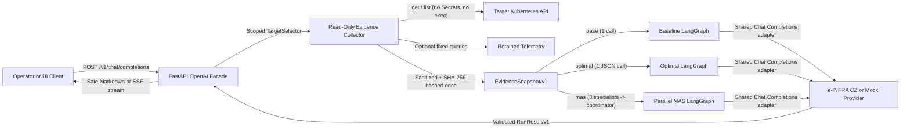

# Getting Started with RCAnnon

RCAnnon diagnoses Kubernetes incidents from an independent management host and compares three LangGraph workflow variants (`base`, `optimal`, and `mas`) over identical, sanitized cluster evidence.

## How RCAnnon Works

RCAnnon keeps the diagnostic runtime outside the failing cluster's node, CNI, ingress, and monitoring failure domains:



1. **Scoped, read-only collection:** `TargetSelector` resolves an allowlisted cluster alias and namespace scope to an isolated Kubernetes `ApiClient`. The collector reads workloads, events, bounded pod logs, metrics, and read-only checks—never `Secret` values, `pod exec`, or write operations.
2. **Redaction and single-hash snapshot:** Secrets, bearer tokens, and kubeconfig credentials are scrubbed once before producing an immutable `EvidenceSnapshot/v1` with per-source coverage statuses (`observed`, `truncated`, `forbidden`, `unreachable`, `unsupported`, `timeout`).
3. **Three comparable LangGraph workflows:**
   - `base`: one model call returning a free-text diagnosis.
   - `optimal`: one model call returning a schema-validated five-field RCA JSON (`cause`, `causal_chain`, `supporting_evidence`, `remediation`, `recovery_check`).
   - `mas`: parallel fan-out across three domain specialists (`k8s-config-events`, `logs-connectivity`, `metrics-telemetry`) followed by a synthesis `coordinator` (four logical calls total).
4. **Controlled degradation:** If the target cluster or metrics endpoint is partially or completely unavailable, RCAnnon returns `qualified` (with explicit `limitations`) or `insufficient_evidence` rather than fabricating certainty.

## Prerequisites

- **Containerized quick start:** Docker Engine / Docker Desktop and Docker Compose v2.
- **Local Python development:** [`uv`](https://docs.astral.sh/uv/) (automatically uses Python `3.12` pinned in `.python-version`).
- **Optional Kubernetes lab:** `kind`, `kubectl`, and `helm` for running the local 16-scenario cluster.

## Quick Start with Docker Compose (Offline Mock Mode)

You can verify the full stack locally without a Kubernetes cluster or an LLM API key.

1. Clone the repository and generate distinct local development secret files:

```sh
git clone https://github.com/jkuzel02/RCAnnon.git
cd RCAnnon
./infrastructure/compose/scripts/init-dev-secrets.sh
```

2. Validate the Compose definition, start the stack (`api`, `mongodb`, and LibreChat `ui`), and seed the initial local administrator account:

```sh
# Option A: Build locally
docker compose config --quiet
docker compose up -d --build --wait
docker compose --profile bootstrap run --rm ui-bootstrap

# Option B: Pull prebuilt multi-arch API image from GHCR
RCANNON_IMAGE=ghcr.io/jkuzel02/rcannon:0.1.0 docker compose up -d --no-build --wait
docker compose --profile bootstrap run --rm ui-bootstrap
```

3. Verify LibreChat is healthy on loopback (`127.0.0.1:3080`) and sign in through the browser:

```sh
curl -fsS http://127.0.0.1:3080/health
```

Open `http://127.0.0.1:3080`, log in with `admin@rcannon.local` and the generated password in `infrastructure/compose/secrets/librechat_admin_password.secret`, select a model (`rcannon-base`, `rcannon-optimal`, or `rcannon-mas`), and submit `/rca context=lab namespace=demo -- checkout is failing`.

For operator-only API checks without going through LibreChat, see [infrastructure/compose/README.md](../infrastructure/compose/README.md).

4. To enable **live e-INFRA CZ inference** and **read-only target Kubernetes collection**, add the Compose overlays documented in [infrastructure/compose/README.md](../infrastructure/compose/README.md):

```sh
docker compose \
  -f compose.yaml \
  -f infrastructure/compose/compose.einfra.yaml \
  -f infrastructure/compose/compose.kube.yaml \
  up -d --wait
```

## Local Development and Testing (`uv`)

Install dependencies into `.venv` and run the unit and contract test suites:

```sh
uv sync
uv run pytest tests -rx
```

To run live prompt smoke checks against e-INFRA CZ, see [evaluation/prompt_checks/README.md](../evaluation/prompt_checks/README.md).

## Running the Local Kind Lab

To provision a disposable local Kubernetes lab with Flux CD and 16 incident scenarios:

```sh
./infrastructure/k8s/bootstrap.sh
```

See [infrastructure/k8s/README.md](../infrastructure/k8s/README.md) and [docs/scenarios.md](./scenarios.md) for cluster setup, fault injection, and cleanup commands.

## Documentation Index

| Document | Purpose |
| --- | --- |
| [docs/architecture.md](./architecture.md) | Ratified `v1` architecture decision record, failure domains, and shared data/API contracts |
| [docs/container-image.md](./container-image.md) | GHCR image coordinates, tags (`0.1.0`, `main`, `sha-*`), runtime configuration, and provenance verification |
| [infrastructure/compose/README.md](../infrastructure/compose/README.md) | Docker Compose deployment, secret handling, Linux/macOS Kind reachability, and backups |
| [docs/scenarios.md](./scenarios.md) | Sixteen Kubernetes incident scenario specifications and dataset rules |
| [docs/testing.md](./testing.md) | Workflow testing interface (`rca.workflows.build_workflow`) and mock execution guide |
| [infrastructure/k8s/README.md](../infrastructure/k8s/README.md) | Kind + Flux CD target lab bootstrap and monitoring setup |
| [CHANGELOG.md](../CHANGELOG.md) | Automated Conventional Commits release history |
| [CONTRIBUTING.md](../CONTRIBUTING.md) | Branching, commits, version alignment (`0.1.0`), PR approval, and AI agent rules |
