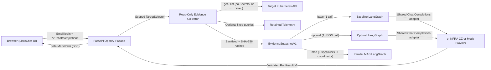

# User Guide — Getting Started with RCAnnon

**RCAnnon** diagnoses Kubernetes incidents from outside the target cluster's failure domain—whether on a standalone Docker Compose host or inside a separate management Kubernetes cluster—using an authenticated **LibreChat** web UI, a read-only Kubernetes evidence collector, and three selectable LangGraph diagnostic workflows (`rcannon-base`, `rcannon-optimal`, and `rcannon-mas`).

## Prerequisites

- **Reference Compose quick start:** Docker Engine or Docker Desktop with Docker Compose v2 (no local Python environment required).
- **Separate management Kubernetes cluster:** Any Kubernetes cluster that can run the published `ghcr.io/jkuzel02/rcannon`, LibreChat (`v0.8.9`), and MongoDB (`8.0`) containers and reach target clusters.

## 60-Second Quick Start (Offline Mock Mode)

Try the full authenticated UI + FastAPI + MongoDB stack on your workstation without a Kubernetes cluster or an external LLM API key:

1. Clone the repository and generate local runtime secret files:

```sh
git clone https://github.com/jkuzel02/RCAnnon.git
cd RCAnnon
./infrastructure/compose/scripts/init-dev-secrets.sh
```

2. Validate the Compose stack, pull the prebuilt API image, start all services, and seed the initial local administrator account:

```sh
docker compose config --quiet
RCANNON_IMAGE=ghcr.io/jkuzel02/rcannon:latest docker compose up -d --no-build --wait
docker compose --profile bootstrap run --rm ui-bootstrap
```

3. Confirm LibreChat is healthy on loopback (`127.0.0.1:3080`):

```sh
curl -fsS http://127.0.0.1:3080/health
```

4. Open **`http://127.0.0.1:3080`** in your browser:
   - **Email:** `admin@rcannon.local`
   - **Password:** the generated string inside `infrastructure/compose/secrets/librechat_admin_password.secret`
   - Choose a model (`rcannon-base`, `rcannon-optimal`, or `rcannon-mas`) and submit an `/rca` prompt:

```text
/rca context=lab namespace=demo -- checkout is failing
```

For multi-user account creation, password recovery, container security inspection, and volume backups, see [Compose Operations](../infrastructure/compose/README.md).

## How RCAnnon Works

RCAnnon keeps the diagnostic runtime strictly outside the target cluster's node, CNI, ingress, and monitoring failure domains:



- **Scoped, read-only collection:** Reads workloads, events, bounded pod logs, metrics, and read-only checks only within allowlisted cluster aliases and namespaces—never reads `Secret` values, runs `pod exec`, or mutates resources.
- **Redaction and single-hash snapshots:** Credentials and bearer tokens are scrubbed before producing an immutable `EvidenceSnapshot/v1`.
- **Honest degradation:** When cluster telemetry or metrics are missing or RBAC-denied, RCAnnon reports `qualified` (with explicit `limitations`) or `insufficient_evidence` instead of guessing.

### Choosing a Model Alias

| Model Alias | Strategy | Calls | Output Format | When to Use |
| --- | --- | --- | --- | --- |
| `rcannon-base` | Single-agent free-form | 1 | Free-text Markdown | Quick narrative diagnosis |
| `rcannon-optimal` | Structured single-agent | 1 | 5-heading structured RCA | Fast, concise root-cause report |
| `rcannon-mas` | 3 parallel specialists -> coordinator | 4 | 5-heading RCA + claim cross-checks | Multi-signal incidents (config, logs, metrics) |

## Connect a Live LLM & Real Kubernetes Cluster

To diagnose incidents in a real cluster using live e-INFRA CZ (or compatible OpenAI) inference:

1. Place your LLM API token in `infrastructure/compose/secrets/llm_api_key.secret` (no trailing quotes).
2. Place a read-only kubeconfig (plus any relative CA/client certificates) in `infrastructure/compose/kubeconfig/config`. RCAnnon rejects `exec` plugins, `auth-provider` blocks, and `insecure-skip-tls-verify: true`.
3. Launch with both Compose overlays (see [Compose Operations](../infrastructure/compose/README.md) for Linux/macOS Kind bridge networking details):

```sh
docker compose \
  -f compose.yaml \
  -f infrastructure/compose/compose.einfra.yaml \
  -f infrastructure/compose/compose.kube.yaml \
  up -d --wait
```

## "So I Can't Run RCAnnon Inside a Kubernetes Cluster?"

**You can.** Docker Compose is simply the quickest single-machine deployment path, not a platform restriction.

- **Intentional design — outside the *target* cluster's failure domain:** Keep RCAnnon independent from whichever cluster you are investigating so node, CNI, CoreDNS, ingress, or monitoring failures in that cluster cannot knock out your diagnostic tool.
- **Running in another Kubernetes cluster works cleanly:** Deploy the multi-arch container image ([Container Image](../docs/container-image.md)) alongside LibreChat and MongoDB in a **separate management or operations cluster**, mount target cluster kubeconfigs as read-only Secrets, and point LibreChat at the in-cluster `api` Service (`http://<api-service>:8000/v1`).
- **Running in the *same* cluster:** Nothing prevents it in code, though it trades away blast-radius independence during cluster-wide outages.

## User Documentation

| Guide | What It Covers |
| --- | --- |
| [Compose Operations](../infrastructure/compose/README.md) | Service topology, LibreChat user/admin management, live overlays, Kind reachability, and backups |
| [Compose Secret Files](../infrastructure/compose/secrets/README.md) | Secret files, formatting requirements, UID ownership (`1000` vs `10001`), and permissions |
| [Container Image](../docs/container-image.md) | GHCR image tags (`latest`, `0.1.3`, `main`, `sha-*`), runtime variables, and SLSA provenance | <!-- x-release-please-version -->
| [Architecture & `v1` Contracts](../docs/architecture.md) | Trust boundaries, redaction guarantees, and OpenAI/operator API surface |

---

*Want to build from source, run the test suite, or contribute? See **[CONTRIBUTING.md](../CONTRIBUTING.md)**.*
